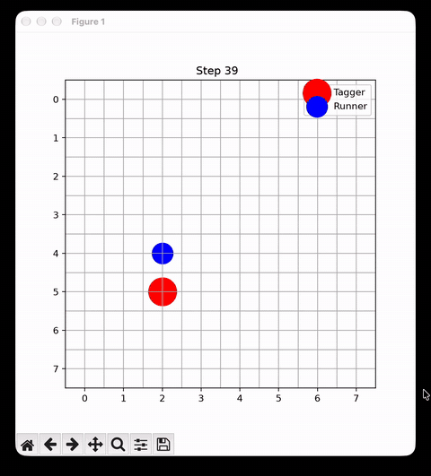

# MARL Tag: Self-Play Tagger vs Runner

A two-agent pursuit game on an 8x8 grid where a **tagger** tries to catch a **runner**, and the runner tries to survive.
Both agents are trained with PPO (Stable-Baselines3) using alternating self-play.

## Game Rules

- 8x8 grid. Tagger and runner start on two different random cells.
- Both agents see the full state: `[tagger_row, tagger_col, runner_row, runner_col]`, scaled to [0, 1].
- Both move **at the same time**, one cell per step. Moving into a wall keeps the agent in place.
- A **tag** happens only if both agents end on the **same cell** after moving. Swapping cells does not count.
- An episode ends on a tag (`terminated`) or after 64 steps (`truncated`).

## Actions

| Action | Move |
|---|---|
| 0 | Up |
| 1 | Down |
| 2 | Left |
| 3 | Right |

## Rewards

The game is zero-sum: the runner's reward is always the exact opposite of the tagger's.

| Event | Tagger | Runner |
|---|---|---|
| Tag (runner caught) | +64 | -64 |
| Every other step | -1 | +1 |

## Training

Alternating self-play: one agent learns while the other is frozen, then the roles swap.

1. Train the tagger against the current runner (random in the first phase).
2. Train the runner against the updated tagger.
3. Repeat.

| Setting | Value |
|---|---|
| Algorithm | PPO (`MlpPolicy`) |
| Iterations | 10 |
| Timesteps per role per iteration | 20,000 |
| Parallel envs | 8 |
| `n_steps` | 128 |

## Evaluation

Cross-play over 200 fixed-seed episodes. "Random" means the agent picks a random action every step.
Rewards are shown for the tagger (T) and the runner (R).

| Tagger | Runner | Catch rate | Survival rate | Mean length | T reward | R reward |
|---|---|---|---|---|---|---|
| random | random | 41.5% | 58.5% | 49.9 | -22.9 | +22.9 |
| random | trained | 12.0% | 88.0% | 59.2 | -51.4 | +51.4 |
| trained | random | 96.0% | 4.0% | 20.3 | +42.1 | -42.1 |
| trained | trained | 54.5% | 45.5% | 33.9 | +1.5 | -1.5 |

- The trained tagger catches a random runner 96% of the time, versus a 41.5% baseline.
- The trained runner cuts a random tagger's catch rate from 41.5% to 12%.
- Trained vs trained is close to even, with a slight edge to the tagger.

## Demo

Trained tagger (red) chasing the trained runner (blue):

